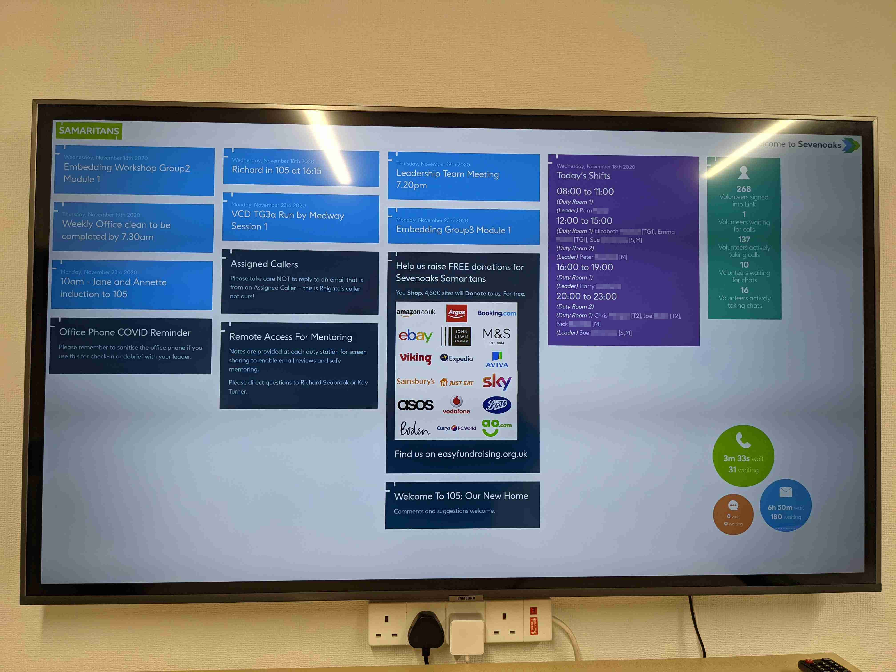
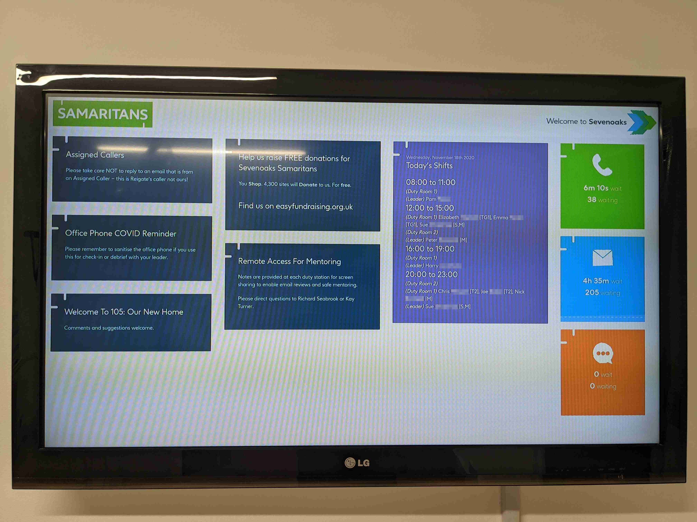

# samaritans-dashboard

A status dashboard for [Samaritans](https://www.samaritans.org/) branches utilising [Three Rings](https://www.threerings.org.uk/). It shows messages posted by authorised users (via the 3R wiki), a scrolling news ticker, today's shifts, events for the coming week and the status of inbound communications channels. It can be easily customised with a basic understanding of HTML, CSS and Javascript.

Predominantly designed for use on large screen TVs, there are two display modes which are selected automatically based on the screen size. It is strongly recommended to be utilised on 4K TVs for the additional screen real-estate:

This was originally written by [richardseabrook](https://github.com/richardseabrook/samaritans-dashboard) for [Sevenoaks Samaritans](https://www.samaritans.org/sevenoaks/), and is now utilised in a number of branches. This fork adds the news ticker and the other features listed below.

## Features

* **Messages** - each page in the 'Branch Comms Screens' 3R wiki is shown as a message tile.
* **News ticker** - the bullet points of one wiki page (see [Three Rings](#three-rings)) scroll along the bottom of the screen.
* **Today's shifts** - the shift that is on now is highlighted with a *Now* label, and any shift that has not yet finished and has nobody on it is flagged *No volunteers* in orange.
* **Events** - events in the next 7 days (4K mode only).
* **Contact channels** - realtime queue statistics for each contact method from the SCO dashboard.
* **Resilience for an unattended screen**:
  * Data is refreshed every 15 minutes (configurable), and straight away at midnight so the date and shifts roll over to the new day.
  * A feed that fails is retried after 30 seconds, backing off to every 5 minutes. Its last data stays on screen with a small *Showing ... from HH:mm - reconnecting* note; the red *Unable to access ... data feed* banner only appears if it has not loaded for two refresh intervals.
  * The page reloads itself once a day at 3am, but only once it has checked the server is answering.
  * The app container restarts itself if its web server stops answering.

## Usage

This code was written to be utilised on the low-cost and low-energy [Raspberry Pi](https://www.raspberrypi.com/) (Pi 3, 4 and 5 are supported, 64bit only), via [balenaCloud](https://www.balena.io/) which allows easy remote management and is free for our use case.

This repo contains configuration to run a multi-container stack on each device:

* **app** - an [nginx](https://nginx.org/) web server serving a single page web app ([Vue.js](https://vuejs.org/)/[jQuery](https://jquery.com/)/[UIkit](https://getuikit.com/)), and acting as an authentication/[CORS](https://en.wikipedia.org/wiki/Cross-origin_resource_sharing) proxy to the 3R API and SCO dashboard.
* **browser** - a kiosk-mode Chromium web browser displaying the app.

The 3R API is used for shift, event and message data, while the SCO dashboard provides the contact channel statistics.

## Equipment

In our branch, we used:

1 x 4k TV (donated)

1 x 1080p Monitor (donated)

2 x [Raspberry Pi 4 Model B - 2GB](https://thepihut.com/products/raspberry-pi-4-model-b?variant=20064052674622)

2 x [FLIRC Raspberry Pi 4 Case](https://thepihut.com/products/flirc-raspberry-pi-4-case?variant=20649168404542)

2 x 16GB Micro SD Card (a good quality brand)

2 x [Official UK Raspberry Pi 4 Power Supply (5.1V 3A) - White](https://thepihut.com/products/raspberry-pi-psu-uk?variant=20064004505662)

2 x [Official Raspberry Pi 4 Micro-HDMI Cable - 1M / White](https://thepihut.com/products/micro-hdmi-to-standard-hdmi-a-cable?variant=31597424934974)

* One Pi is needed per screen.
* Use a good quality metal case, so that heat can be dissipated adequately.

> [!CAUTION]
> Do not try to use old USB power supplies or low-quality SD cards! Under-rated power supplies may damage your device and result in unpredictable results. Watch out for *The device is undervolted!* at the top of each device page. Sticking to official power supplies, as above, will avoid this issue.

## Deployment

### Three Rings

* Create a new Wiki in 3R called 'Branch Comms Screens' (the dashboard looks for this exact name). Any pages you create in here will become on-screen messages. You may want to use 3R permissions to restrict the ability to change these and/or use the lock functionality.
* To use the news ticker, add a page to this wiki named 'Ticker' (or whatever *TICKER_PAGE_NAME* is set to) containing a bullet list - each bullet scrolls along the ticker in turn. This page is not shown as a message tile. The page must contain only bullet points (blank lines are fine, nested bullets are shown alongside the rest); if it contains anything else, or does not exist, the ticker is hidden and the message tiles use the space.
* Create a new role in 3R called something similar to 'Branch Comms Screens'.
* Grant this role View on Events, under Directory Access grant View for all core roles, tick Directory Self-manage, View for Wiki and View for Stats and enable it as a Core role.
* Create a volunteer called 'Branch Comms Screens' with only this role, log in as this new account and add an API key for them via their Directory page.
* For each rota you want the screen to display, ensure Branch Comms Screens has View permissions over it.
* For the most part, we ensure that no other role can view or manage the Branch Comms Screens role, so that it does not appear in the Directory or risk being deleted.

### balenaCloud

* Download and install [balenaEtcher](https://etcher.balena.io/) which we will use to write to SD cards.
* Sign up for a [balenaCloud](https://www.balena.io/) account, which is free for up to 10 devices.
* Click the following button:

* Ensure the default device type matches the type of Pi you are using for your project. You must run 64bit OS (the only option for Pi 4 onwards).
* Click the **Advanced** toggle switch and set the fleet variables:
  * *SITE_NAME* - eg. Sevenoaks. This is used for the 'Welcome to' dashboard header and needs to be relatively short.
  * *THREERINGS_APIKEY* - the API key you obtained above.
  * *REFRESH_INTERVAL_MINUTES* (optional) - how often the dashboard reloads its data. Defaults to 15.
  * *TICKER_PAGE_NAME* (optional) - the wiki page whose bullets scroll along the ticker. Defaults to 'Ticker'.
* Click **Create and deploy**.

These variables can be changed later under **Variables** on your fleet page.

Now let's set up each device:

* Click **Add device**.
* Ensure your device type matches that which you will be using. You must use 64bit OS where you have multiple options.
* It is usually best to connect your device using a network cable, but if you want to use WiFi, select *Wifi + Ethernet* and enter your network details.
* All other details can be left at their default values.
* Click **Flash** this should open balenaEtcher ready to go with your customised image. Select your SD card using **Select target** and then **Flash!**. If your SD card shows *Locked* then operate the physical locking slide on the card adaptor to allow writes.
* Once this has finished, you can make further copies using the same file for each device now - or you can return to your fleet page later and add more.
* Plug your SD card into your Pi, connect your network (optional), HDMI (ensure you use HDMI0) and power cables and boot it.
* You should see the logo boot screen on the device. This will stay for a few minutes while software is deployed to the unit. However you should see the new device appear almost immediately on your fleet dashboard with download progress and logs shown. If this doesn't happen, you may want to check the network connection.
* The device may restart a few times while settings are applied, but once components have downloaded and are ready, the Samaritans Dashboard should load.

> [!TIP]
> Your screen resolution should be auto-detected, but if not, go to **Device Variables** for the specific device, **Add variable** set name to *WINDOW_SIZE* (in capitals) with a value of the desired resolution with a comma in between - eg. 1920,1080 or 3840,2160. Locate the correct value in your display documentation.

You may also want to manually set your resolution if you see the low-resolution version (square queue statistic boxes, rather than circles and no event information) when you have a 4K resolution or higher display.

If you see the logo boot screen for a very long period, check balenaCloud - especially that the device is shown in the fleet (if not, check network) and shows progress downloading images. Also check there are no warnings about incorrect voltage (incorrect power supply).

## Customisation

The majority of changes you may want to make will be in app/html/index.html, which contains the page, its styles and its scripts.

To change the breakpoint between the two screen modes change any reference to 3800px to a new value. Also change 3799px to a value one lower than your new setting.

## Testing

You can access the app directly at http://LOCAL.IP.ADDRESS/ and a screenshot of how the browser is displaying it at http://LOCAL.IP.ADDRESS:5011/screenshot
Where LOCAL.IP.ADDRESS is the *LOCAL IP ADDRESS* value shown in the device page on balenaCloud.

To allow easy testing of the two resolution modes, you can use the files at http://LOCAL.IP.ADDRESS/test_1080p.html and http://LOCAL.IP.ADDRESS/test_4k.html.

## Credits

This code is heavily inspired by [3R My Branch Today](https://github.com/ThreeRingsCIC/3r-shifts-events-news).
